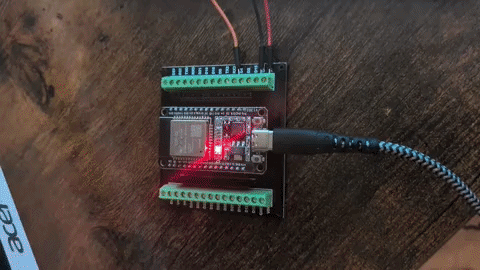
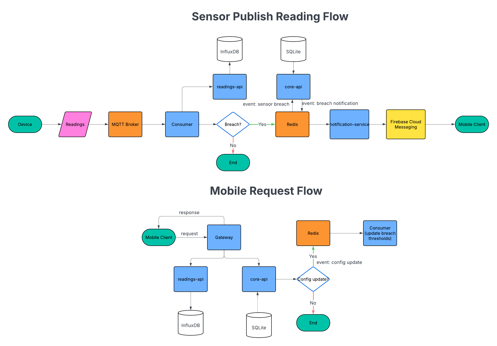

# TankWatch — Server

TankWatch is a personal IoT aquarium monitoring system. I'm building it to collect data to help me understand what's 'really' happening inside my aquarium. I hope for it to one day give me insight into why my fish and plants thrive.. or not. Plus it's a fun intersection between my interest in coding and fishkeeping.

Right now, the key features are:
- Visualizing historical sensor data through a mobile client app 
- Receiving alert notifications when sensor readings breach a configured threshold

The idea is sensors connected to an ESP32 board publish to an MQTT broker on a self-hosted home server. The backend monitors incoming readings and alerts the mobile client when they breach their configured threshold. The backend also offers an API for the mobile client to gather historical sensor data.

This repo contains the backend: Node.js/TypeScript microservices, a Mosquitto MQTT broker, InfluxDB for time-series data, SQLite for config, and Redis as an internal event bus.

**Related repos:** [tankwatch-android](https://github.com/garrettforsyth/tankwatch-android) · [tankwatch-firmware](https://github.com/garrettforsyth/tankwatch-firmware)

---

## Demo



---

## Overview
The backend has taken an event-driven microservice approach. Currently the backend handles sensor readings published by device sensors, provides data to the mobile client app, and alerts the client app when reading thresholds are breached.

For simplicity, all backend services and infrastructure run as one Docker Compose stack on a single self-hosted Ubuntu server, reachable over a private Tailscale network. Though this is a personal project with limited data volume, design decisions were made with reliability, scalability, and maintainability in mind: 

- The microservice approach offers resilience; a fault in one service doesn't bring down the others. 
- It also offers scalability, since services could be distributed across machines or scaled independently as load grows (the consumer, for example, could be replicated horizontally to handle higher reading volume without touching any other service). 
- It is also maintainable; Each service also owns a single responsibility and a single data store: core-api owns SQLite, readings-api owns InfluxDB, the gateway owns nothing (which keeps each component focused and independently understandable)

Roadmap:
- Additional sensor support: water level, total dissolved solids (TDS), pH
- Authentication: currently stubbed - intend on using Clerk
- Device provisioning flow
- Sensor configuration

## Architecture / Data Flow



### Normal reading (every 30 seconds)
1. ESP32 reads DS18B20, publishes `{ "value": 24.0625 }` to `tankwatch/{deviceId}/readings/temperature/ds18b20/{romAddress}`
2. Consumer writes measurement to InfluxDB
3. Consumer evaluates against cached thresholds
4. In range → done. Breach → `sensor:breach` → core-api enriches → `notification:dispatch` → notification-service checks cooldown → FCM

### Config update
1. Android calls `PUT /api/sensors/:id/config`
2. Core-api writes to SQLite, publishes fat `sensor:config-updated` event to Redis
3. Consumer updates in-memory threshold cache directly from event payload — no re-fetch

---

### Services

| Service | Role |
|---|---|
| **gateway** | Backend-for-Frontend pattern (BFF), only externally exposed service. Proxies `/api/*` to core-api and readings-api. |
| **core-api** | Owns SQLite — devices, sensors, config, FCM tokens. Handles breach enrichment (gathers details for breach notification) and config updates. |
| **readings-api** | Thin InfluxDB query layer. Read-only time-series access. |
| **consumer** | Subscribes to MQTT, writes readings to InfluxDB, evaluates thresholds, publishes breach events to Redis. |
| **notification-service** | Subscribes to Redis `notification:dispatch`, applies 30-minute cooldown per sensor/direction, sends FCM. |

### Infrastructure (Docker)

| Component | Role |
|---|---|
| Mosquitto | MQTT broker — receives ESP32 publishes |
| InfluxDB v2 | Time-series readings |
| Redis | Internal pub/sub event bus |
| SQLite | Domain store — not containerized, flat file on disk |

### Network exposure

Nothing is exposed to the public internet. Clients reach the server over a private [Tailscale](https://tailscale.com) network (tailnet); the ESP32 publishes over the home LAN. Only two ports are published by the Compose stack:

| Port | Purpose | Reachable from |
|---|---|---|
| 3000 | Gateway API | LAN + tailnet |
| 1883 | MQTT (ESP32 publishes) | LAN + tailnet |

Every other service (core-api, readings-api, Redis, InfluxDB, …) is only reachable on the stack's internal Docker network. The gateway only forwards the client-facing route groups below; core-api's service-to-service `/internal/*` routes are not exposed.

---|---|
| 22 | SSH |
| 80 | HTTP (nginx — Certbot verification + HTTP→HTTPS redirect) |
| 443 | HTTPS API (nginx → gateway:3000) |
| 1883 | MQTT (ESP32 publishes) |

---

## API Endpoints

All routes go through the gateway (port 3000 on the server).

| Method | Path | Description |
|---|---|---|
| `GET` | `/api/devices` | List devices for the current user |
| `GET` | `/api/devices/:id/sensors` | List sensors for a device |
| `GET` | `/api/readings` | Time-series readings (`?romAddress=&measurementType=&range=`) |
| `GET` | `/api/sensors/:id/config` | Sensor threshold config |
| `PUT` | `/api/sensors/:id/config` | Upsert sensor threshold config |
| `PUT` | `/api/notifications/token` | Register/update FCM push token |

---

## Local Development

### Prerequisites

- Node.js 22
- Docker Desktop
- Mosquitto installed natively on Windows (Docker's WSL2 networking stack prevents ESP32 from reaching a containerized broker)

### 1. Clone and install

```bash
git clone https://github.com/garrettforsyth/tank_watch_server
cd tank_watch_server
npm install        # always from the root — never from a sub-package
```

### 2. Environment files

Each service reads from `.env.development`. Copy the examples and fill in your values:

```bash
cp notification-service/.env.example notification-service/.env.development
```

**core-api** `.env.development`:
```
SQLITE_DB_PATH=../tankwatch.db
```

**notification-service** `.env.development`:
```
REDIS_HOST=localhost
REDIS_PORT=6379
FIREBASE_SERVICE_ACCOUNT_PATH=./firebase-service-account.json
```

Place your Firebase service account JSON at `notification-service/firebase-service-account.json` (gitignored via `*adminsdk*`).

### 3. Start infrastructure

```bash
docker compose -f docker-compose.dev.yml up -d
```

This starts InfluxDB (port 8086) and Redis (port 6379). Start Mosquitto natively:

```bash
net start mosquitto      # Windows
```

### 4. Migrate and seed the database

```bash
npm run db:migrate -w core-api
npm run db:seed -w core-api
```

If you need to re-seed, delete `tankwatch.db` first.

### 5. Start all services

```bash
npm run dev
```

This builds `shared-infra` first (via `predev`), then starts all five services concurrently.

To run a single service:

```bash
npm run dev -w core-api
npm run dev -w consumer
```

### Useful commands

```bash
npm run db:studio -w core-api        # Drizzle Studio at localhost:4983
npm run typecheck --workspaces       # type-check all packages
npm run test --workspaces            # run all tests
```

---

## Tests

Vitest across `consumer`, `core-api`, and `readings-api`.

```bash
npm run test --workspaces --if-present
```

- **consumer** — `AlertEvaluator` unit tests (pure function, no I/O)
- **core-api** — Zod schema unit tests + supertest integration tests against in-memory SQLite
- **readings-api** — Zod schema unit tests

---

## Deployment

The server is a self-hosted Ubuntu machine on a Tailscale network. Everything — Mosquitto, InfluxDB, Redis and the five Node services — runs from `docker-compose.yml`, built from the single root `Dockerfile` (`--build-arg SERVICE=<workspace>`). Every container uses `restart: unless-stopped`, so the stack comes back on its own after a reboot.

### First-time setup

```bash
git clone https://github.com/garrettforsyth/tank_watch_server && cd tank_watch_server
cp .env.example .env                # fill in; generate values with: openssl rand -hex 32
mkdir -p secrets                    # place firebase-service-account.json here

# MQTT users: `consumer` (password = MQTT_CONSUMER_PASSWORD in .env) and `esp32`
touch mosquitto_passwords
docker run --rm -v "$PWD/mosquitto_passwords:/pw" eclipse-mosquitto:2 sh -c \
  'mosquitto_passwd -b /pw consumer <password> && mosquitto_passwd -b /pw esp32 <password> && chown 1883:1883 /pw && chmod 0700 /pw'

docker compose up -d --build
docker compose exec core-api node dist/db/seed.js   # once, on a fresh database
```

core-api applies pending SQLite migrations on every start (`dist/db/migrate.js`).

### Day to day

```bash
docker compose ps                    # status
docker compose logs -f consumer      # follow one service's logs
./deploy.sh                          # pull main and rebuild/restart what changed
```

InfluxDB's UI is bound to the server's loopback only: `ssh -L 8086:localhost:8086 <server>` then open `http://localhost:8086`.

### CI/CD

GitHub Actions runs on push to `main`:

1. `npm ci` → typecheck → Vitest
2. On success: the runner joins the tailnet as a short-lived `tag:ci` device ([tailscale/github-action](https://github.com/tailscale/github-action)) and SSHes to the server with a deploy key that `authorized_keys` restricts to running `deploy.sh`.

Secrets required: `TS_OAUTH_CLIENT_ID`, `TS_OAUTH_SECRET`, `DEPLOY_HOST`, `DEPLOY_USER`, `DEPLOY_SSH_KEY`.

---

## Tech Stack

| | |
|---|---|
| Runtime | Node.js 22 / TypeScript |
| Services | Express |
| Time-series DB | InfluxDB v2 |
| Config DB | SQLite (Drizzle ORM) |
| Event bus | Redis (ioredis) |
| MQTT broker | Mosquitto |
| Push notifications | Firebase Cloud Messaging |
| Package management | npm workspaces |
| Tests | Vitest + supertest |
| Containers | Docker Compose |
| Networking | Tailscale (private tailnet) |
| CI/CD | GitHub Actions |
| Hosting | Self-hosted Ubuntu server |
